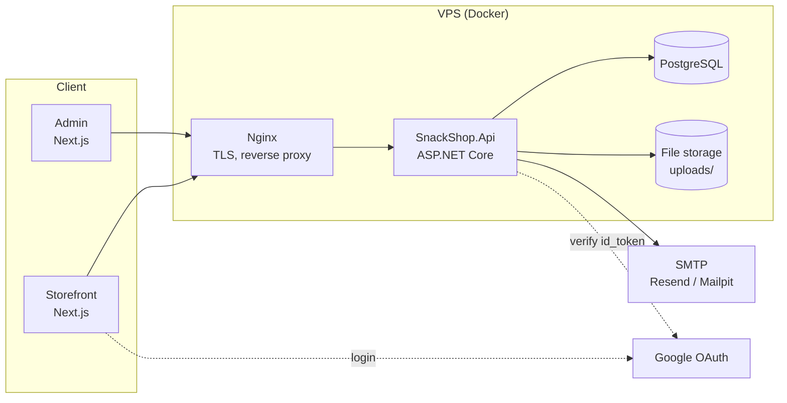
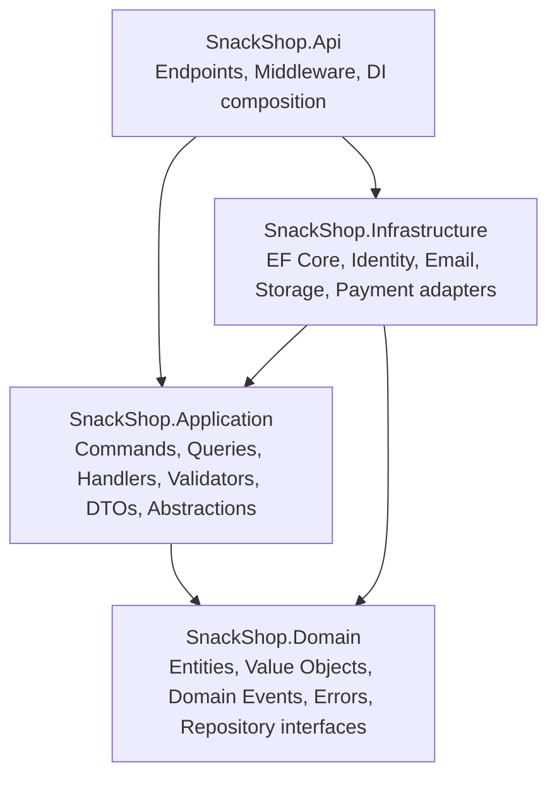
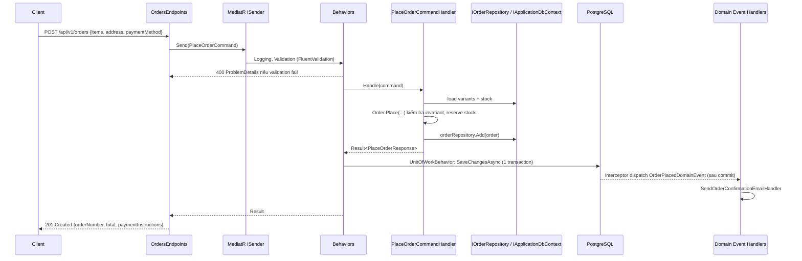

# 02 — Kiến trúc hệ thống

Quyết định gốc: **Clean Architecture monolith**, một solution C#, một tiến trình deploy. Xem lý do ở [ADR-0001](adr/0001-clean-architecture-monolith.md).

## 1. Bức tranh tổng thể



- Frontend và backend **tách rời hoàn toàn**, giao tiếp qua REST JSON. Backend không render HTML.
- Storefront và Admin là **một app Next.js** với 2 route group (`(storefront)`, `(admin)`) ở MVP để đỡ cấu hình. Có thể tách thành 2 app sau.
- Một DB PostgreSQL duy nhất. Không chia schema theo module ở MVP (chia bằng thư mục code là đủ).

## 2. Các lớp và quy tắc phụ thuộc



**Quy tắc phụ thuộc (bắt buộc, có test kiểm tra ở `SnackShop.ArchitectureTests`):**

| Project | Được tham chiếu | Tuyệt đối KHÔNG |
|---|---|---|
| `Domain` | Không gì cả (chỉ BCL) | EF Core, MediatR, ASP.NET, bất kỳ NuGet hạ tầng nào |
| `Application` | `Domain`, MediatR, FluentValidation, `Microsoft.EntityFrameworkCore` (chỉ cho `IQueryable` extension, xem mục 5) | ASP.NET, Npgsql, `DbContext` cụ thể |
| `Infrastructure` | `Application`, `Domain`, EF Core, Npgsql, Identity, thư viện bên thứ ba | `Api` |
| `Api` | `Application`, `Infrastructure` (chỉ để gọi `AddInfrastructure()`) | Gọi `DbContext` trực tiếp, chứa business logic |

Hướng mũi tên luôn **đi vào trong**. Lớp ngoài biết lớp trong, lớp trong không biết lớp ngoài.

## 3. Trách nhiệm từng project

### 3.1 `SnackShop.Domain` — trái tim nghiệp vụ

- **Entities** và **Aggregate Roots**: `Product`, `Order`, `Customer`… có hành vi (`order.Confirm()`, `product.AddVariant()`), không phải túi dữ liệu.
- **Value Objects**: `Money`, `Address`, `Slug`, `OrderNumber`, `Sku`.
- **Enums**: `OrderStatus`, `PaymentMethod`, `PaymentStatus`, `StockMovementType`.
- **Domain Events**: `OrderPlacedDomainEvent`, `OrderConfirmedDomainEvent`, `OrderCancelledDomainEvent`.
- **Domain Errors**: `OrderErrors.CannotCancelAfterConfirmed` — danh sách lỗi có mã, có message, định nghĩa tập trung theo aggregate.
- **Repository interfaces**: `IOrderRepository`, `IProductRepository`, `ICustomerRepository` (chỉ cho aggregate root, chỉ dùng ở phía ghi).
- **Common**: `Entity`, `AggregateRoot`, `ValueObject`, `Result`, `Result<T>`, `Error`, `ErrorType`, `IDomainEvent`.

Domain **không** biết DB, HTTP, JSON. Mọi rule nghiệp vụ "không bao giờ được vi phạm" (invariant) nằm ở đây và được bảo vệ bằng constructor/factory method/method công khai. Property setter là `private`.

Thư mục trong Domain chia theo **module nghiệp vụ**:

```
Domain/
  Common/            Entity, AggregateRoot, ValueObject, Result, Error, IDomainEvent
  Catalog/           Category, Product, ProductVariant, ProductImage, CatalogErrors, IProductRepository
  Inventory/         StockItem, StockMovement, StockMovementType, InventoryErrors
  Ordering/          Order, OrderItem, OrderStatus, OrderStatusHistory, Payment, OrderErrors, IOrderRepository, Events/
  Customers/         Customer, Address, Cart, CartItem, CustomerErrors, ICustomerRepository
  Settings/          ShopSettings (phí ship, tài khoản ngân hàng)
```

### 3.2 `SnackShop.Application` — use case

Tổ chức theo **feature (vertical slice)**, không theo loại file:

```
Application/
  Abstractions/
    Messaging/       ICommand, IQuery, ICommandHandler, IQueryHandler
    Persistence/     IApplicationDbContext, IUnitOfWork
    Services/        ICurrentUser, IEmailSender, IFileStorage, IPaymentGateway,
                     IShippingCalculator, IJwtProvider, IGoogleTokenVerifier, IIdentityService
  Behaviors/         LoggingBehavior, ValidationBehavior, UnitOfWorkBehavior
  Common/            PagedResponse<T>, PagedQuery, MoneyResponse, ValidationError
  Features/
    Orders/
      PlaceOrder/
        PlaceOrderCommand.cs            record : ICommand<PlaceOrderResponse>
        PlaceOrderCommandHandler.cs
        PlaceOrderCommandValidator.cs
        PlaceOrderResponse.cs
      GetOrderByNumber/
        GetOrderByNumberQuery.cs
        GetOrderByNumberQueryHandler.cs
        OrderDetailResponse.cs
      ConfirmOrder/
      CancelOrder/
      ...
    Products/
    Categories/
    Inventory/
    Cart/
    Customers/
    Auth/
    Admin/Reports/
  DependencyInjection.cs               AddApplication()
```

- **Abstractions**: interface mà Infrastructure sẽ hiện thực. Application chỉ biết interface.
- **Behaviors** (MediatR pipeline), thứ tự chạy: `LoggingBehavior` → `ValidationBehavior` → `UnitOfWorkBehavior` (chỉ áp cho `ICommand`) → Handler.
- **DTOs / Responses**: `record`, đặt ngay trong thư mục feature. Không dùng chung DTO giữa các feature trừ khi thật sự giống hệt (`PagedResponse<T>`, `MoneyResponse`).
- **Mapping**: viết tay bằng static method `ToResponse()` hoặc `.Select()` projection. **Không dùng AutoMapper** (xem [ADR-0006](adr/0006-mediatr-v12-no-automapper.md)).

### 3.3 `SnackShop.Infrastructure` — kỹ thuật

```
Infrastructure/
  Persistence/
    ApplicationDbContext.cs
    Configurations/      *Configuration : IEntityTypeConfiguration<T>
    Migrations/
    Repositories/        OrderRepository, ProductRepository, CustomerRepository
    Interceptors/        AuditableEntityInterceptor, DispatchDomainEventsInterceptor
    Seed/                DbSeeder (roles, admin mặc định, dữ liệu mẫu dev)
    UnitOfWork.cs
  Identity/              ApplicationUser, IdentityService, JwtProvider, GoogleTokenVerifier, RefreshToken
  Email/                 SmtpEmailSender (MailKit), Templates/
  Storage/               LocalFileStorage (MVP), S3FileStorage (sau)
  Payments/              CodPaymentGateway, BankTransferPaymentGateway, (VnPayGateway sau)
  Shipping/              FlatRateShippingCalculator
  BackgroundJobs/        ExpireUnpaidBankTransferOrdersJob (hosted service)
  Services/              CurrentUser (đọc từ IHttpContextAccessor), SystemTimeProvider
  DependencyInjection.cs AddInfrastructure(IConfiguration)
```

`AddInfrastructure()` là **điểm vào duy nhất** Api cần gọi để có toàn bộ hạ tầng.

### 3.4 `SnackShop.Api` — cổng HTTP

```
Api/
  Program.cs                 gọn: AddServices → Build → UsePipeline → MapEndpoints → Run
  Endpoints/
    IEndpointGroup.cs        interface { void Map(IEndpointRouteBuilder app); }
    CategoriesEndpoints.cs
    ProductsEndpoints.cs
    CartEndpoints.cs
    OrdersEndpoints.cs
    AuthEndpoints.cs
    MeEndpoints.cs
    Admin/
      AdminProductsEndpoints.cs
      AdminOrdersEndpoints.cs
      AdminInventoryEndpoints.cs
      AdminReportsEndpoints.cs
  Middleware/                GlobalExceptionHandler (IExceptionHandler → ProblemDetails)
  Extensions/                ResultExtensions.ToHttpResult(), AddApiServices(), AddAuth(), MapEndpointGroups()
  Contracts/                 Request record cho body (nếu khác command), ví dụ PlaceOrderRequest
  appsettings.json, appsettings.Development.json
  Dockerfile
```

Endpoint chỉ làm 3 việc: **bind request → gửi command/query → map Result sang HTTP**.

## 4. Luồng xử lý một request (ví dụ: đặt hàng)



Nguyên tắc rút ra:

1. **Endpoint không chứa logic.** Nếu có `if` nghiệp vụ trong endpoint là sai chỗ.
2. **Handler là đơn vị use case.** Một command = một handler = một transaction.
3. **Entity tự bảo vệ invariant.** Handler gọi `order.Cancel(reason)`, không tự gán `order.Status = Cancelled`.
4. **Lỗi nghiệp vụ trả `Result.Failure(Error)`, không throw.** Exception chỉ cho lỗi hệ thống (DB down, bug).
5. **Domain event cho side effect.** Gửi email, cập nhật thống kê, ghi log nghiệp vụ… không nằm trong handler chính.

## 5. CQRS nhẹ: ghi và đọc đi hai đường

| | Command (ghi) | Query (đọc) |
|---|---|---|
| Interface | `ICommand<TResponse>` : `IRequest<Result<TResponse>>` | `IQuery<TResponse>` : `IRequest<Result<TResponse>>` |
| Truy cập dữ liệu | Qua **repository** của aggregate root (`IOrderRepository.GetByIdAsync`) | Trực tiếp **`IApplicationDbContext`**, `AsNoTracking()`, `.Select()` projection sang DTO |
| Transaction | `UnitOfWorkBehavior` tự `SaveChanges` | Không |
| Validator | Bắt buộc có | Có nếu có tham số (page, filter) |
| Trả về | Id / response tối thiểu | DTO đầy đủ cho UI |

Vì vậy `Application` được phép tham chiếu `Microsoft.EntityFrameworkCore` **chỉ** để dùng `ToListAsync`, `AsNoTracking`, `Include`, `FirstOrDefaultAsync` trên `IQueryable` do `IApplicationDbContext` expose (dạng `IQueryable<Product> Products { get; }`). Không được dùng `DbContext`, `DbSet<T>.Add`, migration, hay bất kỳ API Npgsql nào trong Application. Architecture test sẽ chặn.

## 6. Cross-cutting concerns

| Vấn đề | Giải pháp | Nơi đặt |
|---|---|---|
| Validation input | FluentValidation, chạy trong `ValidationBehavior` | Application |
| Validation nghiệp vụ | Trong Domain (method trả `Result`) | Domain |
| Transaction | `UnitOfWorkBehavior` bao quanh command handler | Application (interface), Infrastructure (impl) |
| Audit `CreatedAt/By`, `UpdatedAt/By` | `AuditableEntityInterceptor` | Infrastructure |
| Soft delete | `IsDeleted` + global query filter, chỉ cho `Product`, `Category` | Infrastructure |
| Thời gian | `TimeProvider` (BCL) inject; không gọi `DateTime.UtcNow` trực tiếp trong Domain/Application | Mọi nơi |
| User hiện tại | `ICurrentUser { UserId, Roles, IsAuthenticated }` | Application interface, Infrastructure impl từ `HttpContext` |
| Logging | Serilog structured; `LoggingBehavior` log tên request, thời gian, kết quả | Application + Api |
| Cache | Chưa bật ở MVP (ADR-0009 §8). Frontend dùng ISR 60s cho trang catalog. Khi cần: `HybridCache` cho catalog public, invalidate khi admin sửa | — |
| Error → HTTP | `Error.Type` → status code (xem [05-api-guidelines.md](05-api-guidelines.md)) | Api |
| Domain events | Raise trong entity, dispatch **sau** `SaveChanges` thành công qua `DispatchDomainEventsInterceptor`; handler lỗi chỉ được log (không đổi kết quả request) | Infrastructure |
| Email | `IEmailSender` = hàng đợi in-process (`EmailQueue`) → `EmailDispatcher` (BackgroundService, MailKit, thử lại 3 lần). Template HTML trong `Application/Common/Email` | Application (interface, template), Infrastructure |
| Job nền | `MaintenanceJob` mỗi 10 phút: hủy đơn chuyển khoản quá hạn (`ExpireUnpaidOrdersCommand`), dọn refresh token hết hạn | Infrastructure |
| Rate limiting | ASP.NET Core `RateLimiter` cho `/auth/*` và `POST /orders` | Api |

## 7. Những thứ cố tình chưa làm (và tại sao)

- **Không Outbox pattern ở MVP.** Domain event dispatch in-process sau commit; email đi qua hàng đợi trong bộ nhớ. Nếu gửi email fail thì log lỗi, không rollback đơn; email còn trong hàng đợi sẽ mất nếu process restart đúng lúc. Khi cần đảm bảo delivery → thêm bảng `outbox_messages` + job (Phase 4).
- **Không message bus / Redis / cache.** Một tiến trình, một DB. Khi scale ngang > 1 instance: Redis cho cache, chuyển job nền sang một instance duy nhất (hoặc lock bằng DB).
- **Không tách microservice.** Ranh giới module nằm ở thư mục `Features/*` và `Domain/*`. Nếu một ngày cần tách, mỗi thư mục đó là một ứng viên.
- **Không generic repository `IRepository<T>`.** Mỗi aggregate một repository với method có nghĩa (`GetByOrderNumberAsync`), tránh leak `IQueryable` ra Application ở phía ghi.
- **Không tách read model / database riêng cho query.** Query projection thẳng từ bảng ghi là đủ ở quy mô này.

## 8. Checklist khi thêm một feature mới

1. Entity / method mới trong `Domain` (+ unit test invariant).
2. Thư mục `Application/Features/<Module>/<UseCase>/` với Command|Query + Handler + Validator + Response.
3. Nếu cần abstraction hạ tầng mới → interface trong `Application/Abstractions/`, impl trong `Infrastructure/`, đăng ký trong `DependencyInjection.cs`.
4. Cấu hình EF (nếu entity mới) + migration (xem [06-database.md](06-database.md)).
5. Endpoint trong `Api/Endpoints/<Module>Endpoints.cs`, có `.WithName()`, `.Produces<>()`, `.RequireAuthorization(policy)`.
6. Integration test cho endpoint: 1 happy path + ít nhất 1 failure path.
7. Cập nhật OpenAPI → regenerate frontend client.
8. Nếu thay đổi quyết định kiến trúc → viết ADR.
