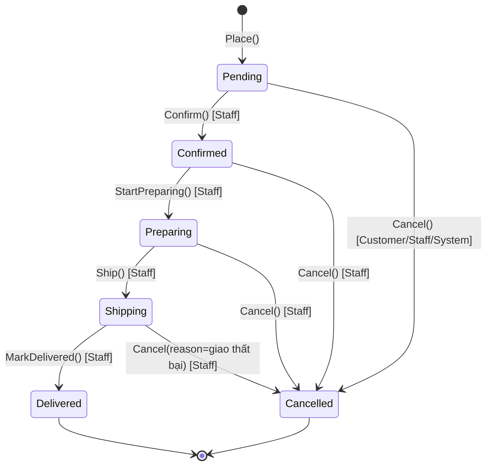

# 03 — Domain model

Tài liệu này mô tả **nghiệp vụ** được mã hóa trong `SnackShop.Domain`. Khi code và tài liệu lệch nhau, sửa một trong hai ngay trong cùng PR.

## 1. Thuật ngữ (Ubiquitous Language)

| Tiếng Việt | Trong code | Nghĩa |
|---|---|---|
| Danh mục | `Category` | Nhóm sản phẩm: Bánh, Kẹo, Hạt, Khô bò, Đồ uống… 1 cấp (có `ParentId` để mở rộng) |
| Sản phẩm | `Product` | Một món bán, ví dụ "Khô gà lá chanh". Là aggregate root của Catalog |
| Biến thể | `ProductVariant` | Một phiên bản mua được của sản phẩm: "Vị cay – 200g", có SKU, giá riêng. Mọi Product có **ít nhất 1** variant (variant mặc định nếu không có tùy chọn) |
| SKU | `Sku` | Mã kho duy nhất của một biến thể |
| Tồn kho | `StockItem` | Số lượng của **một biến thể**: `OnHand` (thực có), `Reserved` (đã giữ cho đơn chưa xác nhận), `Available = OnHand - Reserved` |
| Biến động kho | `StockMovement` | Một dòng lịch sử thay đổi kho: nhập, bán, điều chỉnh, trả hàng |
| Giỏ hàng | `Cart` | Giỏ của customer đã đăng nhập (guest giữ ở client) |
| Đơn hàng | `Order` | Aggregate root của Ordering. Snapshot giá tại thời điểm đặt |
| Mã đơn | `OrderNumber` | Mã người đọc được: `SS-20261022-00042` |
| Thanh toán | `Payment` | Bản ghi thanh toán gắn với đơn; MVP 1 đơn = 1 payment |
| Khách hàng | `Customer` | Hồ sơ mua hàng, tách khỏi `ApplicationUser` (Identity) nhưng dùng chung `Id` |
| Sổ địa chỉ | `Address` | Địa chỉ giao hàng đã lưu của customer |
| Địa chỉ giao hàng | `ShippingAddress` (value object) | Snapshot địa chỉ trong đơn, không tham chiếu `Address` |
| Cấu hình shop | `ShopSettings` | Phí ship, ngưỡng miễn ship, tài khoản ngân hàng nhận chuyển khoản |

## 2. Bounded contexts / modules

```mermaid
flowchart LR
    CAT[Catalog<br/>Category, Product, Variant, Image]
    INV[Inventory<br/>StockItem, StockMovement]
    ORD[Ordering<br/>Order, OrderItem, Payment, StatusHistory]
    CUS[Customers<br/>Customer, Address, Cart]
    IDN[Identity<br/>ApplicationUser, Role, RefreshToken<br/>(Infrastructure)]
    SET[Settings<br/>ShopSettings]

    ORD -- VariantId, snapshot --> CAT
    ORD -- reserve/commit/release --> INV
    ORD -- CustomerId nullable --> CUS
    CUS -- Id dùng chung --> IDN
    INV -- VariantId --> CAT
    ORD -- phí ship --> SET
```

Quy tắc giữa module:

- Module tham chiếu nhau **bằng Id**, không navigation property xuyên aggregate (Order giữ `VariantId`, không giữ `ProductVariant`).
- Order **snapshot** tên sản phẩm, tên biến thể, SKU, đơn giá tại thời điểm đặt. Admin đổi giá sau không ảnh hưởng đơn cũ.
- Inventory thay đổi **chỉ** qua method của `StockItem` và luôn kèm một `StockMovement`.

## 3. Catalog

### `Category` (aggregate root)

| Field | Kiểu | Ghi chú |
|---|---|---|
| `Id` | `Guid` (v7) | |
| `Name` | `string(100)` | Bắt buộc, duy nhất |
| `Slug` | `Slug` VO, `string(120)` | Duy nhất, sinh từ Name, dùng trên URL |
| `Description` | `string(500)?` | |
| `ImageUrl` | `string?` | |
| `SortOrder` | `int` | Thứ tự hiển thị |
| `IsActive` | `bool` | Ẩn/hiện trên storefront |
| `ParentId` | `Guid?` | Để dành, MVP luôn null |
| Audit + `IsDeleted` | | Soft delete |

### `Product` (aggregate root) — sở hữu `ProductVariant[]`, `ProductImage[]`

| Field | Kiểu | Ghi chú |
|---|---|---|
| `Id`, `CategoryId` | `Guid` | |
| `Name` | `string(200)` | |
| `Slug` | `Slug`, duy nhất | |
| `ShortDescription` | `string(300)?` | Hiện ở card |
| `Description` | `text?` | Markdown/HTML đã sanitize |
| `Ingredients`, `Origin`, `Brand` | `string?` | Thông tin đồ ăn |
| `ShelfLifeDays` | `int?` | Hạn dùng |
| `IsActive`, `IsFeatured` | `bool` | |
| `Variants` | `List<ProductVariant>` | ≥ 1 |
| `Images` | `List<ProductImage>` | ≤ 10, đúng 1 `IsPrimary` khi có ảnh |
| `SoldCount` | `int` | Denormalized, tăng khi đơn `Delivered`, dùng sort "bán chạy" |
| `SearchText` | `string` | Tên + thương hiệu bỏ dấu, chữ thường; dùng cho tìm kiếm không dấu (ADR-0009) |
| Audit + `IsDeleted` | | |

**Invariants** (ép trong Domain):
- Không thể `Activate()` nếu không có variant active nào.
- Không xóa variant cuối cùng.
- `AddImage` quá 10 → `CatalogErrors.TooManyImages`.
- `SetPrimaryImage` tự bỏ cờ primary của ảnh khác.

### `ProductVariant` (entity con)

| Field | Kiểu | Ghi chú |
|---|---|---|
| `Id`, `ProductId` | `Guid` | |
| `Name` | `string(100)` | "Vị cay – 200g". Variant mặc định: `"Default"` và không hiển thị tên |
| `Sku` | `Sku` VO, `string(50)`, duy nhất toàn hệ thống | |
| `Price` | `Money` | > 0 |
| `CompareAtPrice` | `Money?` | Giá gốc gạch ngang, phải > `Price` nếu có |
| `WeightGrams` | `int?` | Dùng tính ship sau |
| `IsActive` | `bool` | |
| `SortOrder` | `int` | |

### `ProductImage` (entity con)

`Id`, `ProductId`, `Url`, `AltText?`, `SortOrder`, `IsPrimary`.

## 4. Inventory

### `StockItem` (aggregate root, 1:1 với variant)

| Field | Kiểu | Ghi chú |
|---|---|---|
| `VariantId` | `Guid` (PK) | |
| `QuantityOnHand` | `int ≥ 0` | |
| `QuantityReserved` | `int ≥ 0`, `≤ OnHand` | |
| `LowStockThreshold` | `int` | Mặc định 10, cảnh báo admin |
| `RowVersion` | `uint` (`xmin`) | Optimistic concurrency, bắt buộc |

Method: `Receive(qty, note)`, `Adjust(delta, reason)`, `Reserve(qty)`, `ReleaseReservation(qty)`, `CommitReservation(qty)`, `Return(qty)`. Mỗi method tạo một `StockMovement`.

`Available => QuantityOnHand - QuantityReserved`.

### `StockMovement` (entity, append-only)

`Id`, `VariantId`, `Type` (`Purchase`, `Sale`, `Adjustment`, `Return`, `Reservation`, `ReservationRelease`), `Quantity` (dương/âm theo nghĩa), `ReferenceType?` ("Order"), `ReferenceId?`, `Note?`, `CreatedAt`, `CreatedBy`.

**Chính sách giữ hàng:**

| Sự kiện đơn | Tác động kho |
|---|---|
| Đặt đơn (`Pending`) | `Reserve(qty)` — thiếu hàng → `InventoryErrors.InsufficientStock`, đơn không tạo |
| Xác nhận (`Confirmed`) | `CommitReservation(qty)`: `OnHand -= qty`, `Reserved -= qty`, movement `Sale` |
| Hủy từ `Pending` | `ReleaseReservation(qty)` |
| Hủy từ `Confirmed`/`Preparing` | `Return(qty)`: `OnHand += qty`, movement `Return` |
| Hủy từ `Shipping` trở đi | Admin tự điều chỉnh kho bằng tay (`Adjust`) |

## 5. Ordering

### `Order` (aggregate root) — sở hữu `OrderItem[]`, `OrderStatusHistory[]`, `Payment`

| Field | Kiểu | Ghi chú |
|---|---|---|
| `Id` | `Guid` | |
| `OrderNumber` | `OrderNumber` VO, duy nhất | `SS-yyyyMMdd-NNNNN`, NNNNN là sequence Postgres reset mỗi ngày |
| `CustomerId` | `Guid?` | Null = guest |
| `ContactEmail` | `string` | Để gửi mail, kể cả guest |
| `ShippingAddress` | `ShippingAddress` VO (owned) | `FullName, Phone, Line1, Ward, District, Province, Note?` |
| `Status` | `OrderStatus` | Xem state machine |
| `PaymentMethod` | `Cod` \| `BankTransfer` (sau: `VnPay`, `MoMo`) | |
| `Subtotal` | `Money` | Σ `LineTotal` |
| `ShippingFee` | `Money` | Tính lúc đặt, snapshot |
| `DiscountAmount` | `Money` | MVP = 0, để dành coupon |
| `CouponCode` | `string?` | MVP null |
| `Total` | `Money` | `Subtotal + ShippingFee - DiscountAmount`, luôn ≥ 0 |
| `CustomerNote` | `string(500)?` | |
| `InternalNote` | `string?` | Chỉ admin thấy |
| `PlacedAt`, `ConfirmedAt?`, `ShippedAt?`, `DeliveredAt?`, `CancelledAt?` | `DateTimeOffset` | |
| `CancelReason` | `string?` | |
| `CancelledBy` | `Customer` \| `Staff` \| `System` ? | |
| `Items` | `List<OrderItem>` | ≥ 1 |
| `StatusHistory` | `List<OrderStatusHistory>` | Append-only |
| `Payment` | `Payment` | 1:1 ở MVP |
| `RowVersion` | `xmin` | Chặn 2 staff cùng đổi trạng thái |

### `OrderItem`

`Id`, `OrderId`, `VariantId`, `ProductId`, `ProductName`, `VariantName`, `Sku`, `ImageUrl?` (snapshot), `UnitPrice` (`Money`), `Quantity` (1..99), `LineTotal`.

### `OrderStatusHistory`

`Id`, `OrderId`, `FromStatus?`, `ToStatus`, `ChangedAt`, `ChangedByUserId?`, `Note?`.

### `Payment`

| Field | Ghi chú |
|---|---|
| `Id`, `OrderId` | |
| `Method` | `Cod`, `BankTransfer` |
| `Status` | `Unpaid`, `Paid`, `Refunded`, `Failed` |
| `Amount` | = `Order.Total` |
| `Provider` | `"COD"`, `"BankTransfer"`, sau: `"VNPAY"` |
| `TransactionRef` | Mã GD ngân hàng/cổng, admin nhập tay với chuyển khoản |
| `TransferContent` | Nội dung CK yêu cầu = mã đơn bỏ dấu gạch, ví dụ `SS2026102200042` (ADR-0009) |
| `PaidAt?`, `ConfirmedByUserId?` | |
| `RawPayload` | `jsonb?`, lưu callback cổng thanh toán sau |

### State machine đơn hàng



Bảng chuyển trạng thái (mọi chuyển khác → `OrderErrors.InvalidStatusTransition`):

| Từ | Đến | Ai | Điều kiện / tác dụng phụ |
|---|---|---|---|
| — | `Pending` | Customer/Guest | Có ≥1 item, tất cả variant active, đủ `Available`; reserve kho; raise `OrderPlaced` |
| `Pending` | `Confirmed` | Staff | Với `BankTransfer`: `Payment.Status == Paid` **hoặc** staff xác nhận đã nhận tiền cùng lúc. Commit kho. Raise `OrderConfirmed` |
| `Pending` | `Cancelled` | Customer (đơn của mình), Staff, System (quá 24h chưa CK) | Release kho |
| `Confirmed` | `Preparing` | Staff | |
| `Preparing` | `Shipping` | Staff | Ghi `ShippedAt` |
| `Shipping` | `Delivered` | Staff | Ghi `DeliveredAt`; COD → `Payment.Paid`; tăng `Product.SoldCount` |
| `Confirmed`/`Preparing` | `Cancelled` | Staff | Return kho; nếu đã `Paid` → `Payment.Refunded` + ghi chú |
| `Shipping` | `Cancelled` | Staff | Không tự động trả kho |

Thời điểm `Delivered` và `Cancelled` là **terminal**, không đổi nữa. Sửa sai → tạo đơn mới hoặc điều chỉnh kho tay.

## 6. Customers

### `Customer` (aggregate root)

`Id` (= `ApplicationUser.Id`), `FullName`, `Phone?`, `Email`, `AvatarUrl?`, `Addresses: List<Address>` (≤ 5, tối đa 1 `IsDefault`), `CreatedAt`.

Tạo tự động khi user đăng ký (handler của `UserRegisteredDomainEvent` hoặc trực tiếp trong `RegisterCommandHandler`).

### `Address` (entity con)

`Id`, `CustomerId`, `Label?` ("Nhà", "Công ty"), `FullName`, `Phone`, `Line1`, `Ward`, `District`, `Province`, `IsDefault`.

### `Cart` (aggregate root, 1:1 Customer)

`Id`, `CustomerId`, `Items: List<CartItem>` (`VariantId`, `Quantity` 1..99, `AddedAt`), `UpdatedAt`.

Method: `AddItem(variantId, qty)` (cộng dồn), `UpdateQuantity`, `RemoveItem`, `Clear()`, `Merge(IEnumerable<(variantId, qty)>)` khi guest đăng nhập. Cart **không** lưu giá; giá luôn tính lại lúc hiển thị và lúc checkout.

## 7. Settings

### `ShopSettings` (singleton row)

`Id = 1`, `FlatShippingFee` (`Money`), `FreeShippingThreshold` (`Money?`), `BankName`, `BankAccountNumber`, `BankAccountName`, `BankBin` (để sinh VietQR), `UnpaidBankTransferExpiryHours` (mặc định 24), `OrderEmailFrom`, `ShopName`, `ShopPhone`, `ShopAddress`.

## 8. Value Objects

| VO | Rule |
|---|---|
| `Money` | `decimal Amount`, `string Currency = "VND"`. Không âm trừ khi là discount. Phép `+ - *` chỉ cùng currency. `Zero`. |
| `Slug` | `^[a-z0-9]+(?:-[a-z0-9]+)*$`, ≤ 120 ký tự, có `Slug.FromText("Khô gà lá chanh") => "kho-ga-la-chanh"` (bỏ dấu tiếng Việt). |
| `Sku` | Viết hoa, `^[A-Z0-9-]{3,50}$`. |
| `OrderNumber` | `SS-yyyyMMdd-NNNNN`. Tạo trong repository (cần sequence DB), không trong Domain. |
| `ShippingAddress` | Mọi field bắt buộc trừ `Note`; `Phone` khớp `^0\d{9}$`. |
| `Email` | Lowercase, validate cơ bản. |

## 9. Domain Events

| Event | Raise khi | Handler (Application) |
|---|---|---|
| `OrderPlacedDomainEvent(OrderId)` | `Order.Place()` | Gửi email xác nhận (kèm QR nếu CK); thông báo admin (sau) |
| `OrderConfirmedDomainEvent` | `Confirm()` | Email "đơn đã xác nhận" |
| `OrderShippedDomainEvent` | `Ship()` | Email "đang giao" |
| `OrderDeliveredDomainEvent` | `MarkDelivered()` | Tăng `SoldCount`; email cảm ơn |
| `OrderCancelledDomainEvent(Reason)` | `Cancel()` | Email hủy |
| `StockBelowThresholdDomainEvent(VariantId)` | Sau commit kho mà `OnHand ≤ Threshold` | Ghi cảnh báo cho dashboard |
| *(không dùng event)* | Register | `Customer` được tạo cùng transaction với tài khoản trong `RegisterCommandHandler`; `StockItem` được tạo cùng transaction với biến thể (ADR-0009) |

## 10. ERD (rút gọn, snake_case theo DB)

```mermaid
erDiagram
    categories ||--o{ products : has
    products ||--|{ product_variants : has
    products ||--o{ product_images : has
    product_variants ||--|| stock_items : tracked_by
    product_variants ||--o{ stock_movements : logs
    customers ||--o{ addresses : has
    customers ||--o| carts : has
    carts ||--o{ cart_items : has
    customers |o--o{ orders : places
    orders ||--|{ order_items : contains
    orders ||--o{ order_status_histories : logs
    orders ||--|| payments : paid_by
    asp_net_users ||--o| customers : profile
    asp_net_users ||--o{ refresh_tokens : has

    products {
        uuid id PK
        uuid category_id FK
        varchar name
        varchar slug UK
        bool is_active
        bool is_featured
        int sold_count
        bool is_deleted
    }
    product_variants {
        uuid id PK
        uuid product_id FK
        varchar sku UK
        numeric price_amount
        numeric compare_at_price_amount
        bool is_active
    }
    stock_items {
        uuid variant_id PK_FK
        int quantity_on_hand
        int quantity_reserved
        int low_stock_threshold
    }
    orders {
        uuid id PK
        varchar order_number UK
        uuid customer_id FK_null
        varchar status
        varchar payment_method
        numeric subtotal_amount
        numeric shipping_fee_amount
        numeric total_amount
        timestamptz placed_at
    }
    order_items {
        uuid id PK
        uuid order_id FK
        uuid variant_id
        varchar product_name
        numeric unit_price_amount
        int quantity
    }
    payments {
        uuid id PK
        uuid order_id FK_UK
        varchar method
        varchar status
        varchar transfer_content
        timestamptz paid_at
    }
```

## 11. Quyết định nghiệp vụ đã chốt

1. **Guest checkout được phép.** Cần email + SĐT. Tra cứu đơn bằng `orderNumber + phone`.
2. **Giá nằm ở variant**, không ở product. Product chỉ hiển thị "từ X đ".
3. **Giữ hàng ngay khi đặt** (reserve), tránh oversell. Đơn chuyển khoản không thanh toán trong 24h → System tự hủy và release.
4. **Snapshot mọi thứ vào đơn.** Đơn hàng là bản ghi lịch sử bất biến về mặt giá và địa chỉ.
5. **Phí ship cố định** theo `ShopSettings`, miễn phí từ ngưỡng. Không tính theo khu vực ở MVP.
6. **Soft delete chỉ cho Catalog.** Order, Payment, StockMovement không bao giờ xóa.
7. **Tiền lưu `numeric(18,2)` + currency**, hiển thị VND không lẻ ở frontend.
