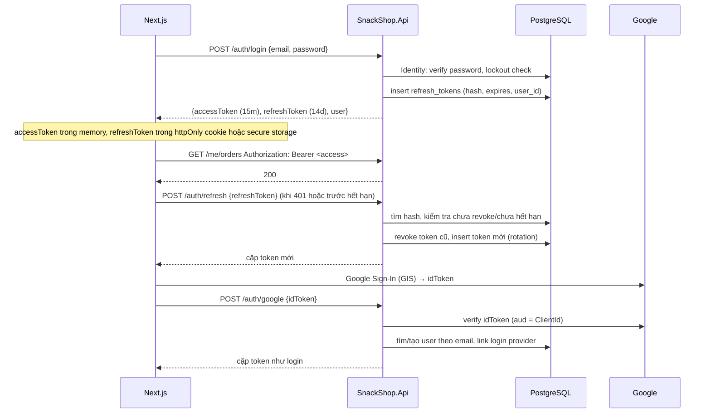

# 07 — Xác thực, phân quyền và bảo mật

Quyết định: ASP.NET Core Identity lưu user trong DB, cấp **JWT access token ngắn hạn + refresh token xoay vòng**, hỗ trợ đăng nhập Google. Lý do: [ADR-0003](adr/0003-identity-jwt.md).

## 1. Mô hình



## 2. Identity

- `ApplicationUser : IdentityUser<Guid>` thêm `FullName`, `AvatarUrl`, `CreatedAt`. `ApplicationRole : IdentityRole<Guid>`.
- Nằm trong `ApplicationDbContext` (cùng migration). Bảng `asp_net_users`… snake_case.
- `Customer` (Domain) có `Id == ApplicationUser.Id`. Identity là chuyện hạ tầng; Domain chỉ biết `Customer`.
- Cấu hình mật khẩu: ≥ 8 ký tự, cần chữ và số; không bắt ký tự đặc biệt (giảm ma sát). Lockout: 5 lần sai → khóa 15 phút.
- Email bắt buộc duy nhất. Số điện thoại không bắt buộc với user Google.
- Xác nhận email: **không chặn** đăng nhập/đặt hàng ở MVP (giảm ma sát), nhưng gửi mail xác nhận và hiển thị nhắc. Có flag `RequireConfirmedEmail` để bật sau.

## 3. Roles và policies

| Role | Gán cho | Ghi chú |
|---|---|---|
| `Customer` | Mọi user tự đăng ký (email hoặc Google) | Mặc định |
| `Staff` | Admin tạo qua `/admin/users` | Không tự đăng ký được |
| `Admin` | Seed user đầu tiên; Admin khác gán | |

```csharp
public static class Roles { public const string Customer = "Customer"; public const string Staff = "Staff"; public const string Admin = "Admin"; }

public static class Policies
{
    public const string Customer = "Customer";   // RequireAuthenticatedUser
    public const string Staff = "Staff";         // RequireRole(Staff, Admin)
    public const string Admin = "Admin";         // RequireRole(Admin)
}
```

- Kiểm tra quyền **thô** (role) ở endpoint bằng policy. Kiểm tra quyền **tinh** (đơn này có phải của tôi) trong handler qua `ICurrentUser`.
- Không hard-code chuỗi `"Admin"` ngoài class `Roles`.

## 4. JWT

| Thiết lập | Giá trị |
|---|---|
| Thuật toán | `HS256` với secret ≥ 64 byte ngẫu nhiên (MVP, 1 service). Chuyển `RS256` khi có service thứ hai cần verify |
| Access token TTL | **15 phút** |
| Refresh token TTL | **14 ngày**, trượt (sliding) khi refresh |
| Issuer / Audience | `snackshop-api` / `snackshop-web`, validate đầy đủ |
| Clock skew | 30 giây |
| Claims | `sub` (userId), `email`, `name`, `role` (nhiều), `jti`, `iat`, `exp` |

Không bỏ gì nhạy cảm vào claim (không SĐT, không địa chỉ). Frontend đọc claim chỉ để hiển thị; mọi quyết định quyền ở server.

`JwtOptions` bind từ `Jwt:*`, `ValidateOnStart()`. Secret **chỉ** đến từ biến môi trường / user-secrets, không bao giờ trong `appsettings.json`.

## 5. Refresh token

Bảng `refresh_tokens`:

| Cột | Ghi chú |
|---|---|
| `id` uuid | |
| `user_id` uuid FK | |
| `token_hash` varchar(128) unique | SHA-256 của token gốc. Token gốc (random 64 byte base64url) **không lưu** |
| `expires_at` timestamptz | |
| `created_at`, `created_by_ip` | |
| `revoked_at`, `revoked_reason` | `Rotated`, `Logout`, `Reuse`, `Admin` |
| `replaced_by_token_hash` | Chuỗi xoay vòng để phát hiện reuse |
| `device_label` | User-Agent rút gọn, hiển thị "thiết bị đang đăng nhập" (Phase 2) |

Quy tắc:
- **Rotation**: mỗi lần refresh → token cũ revoke (`Rotated`), cấp token mới.
- **Reuse detection**: refresh bằng token đã revoke → revoke **toàn bộ** token của user đó (`Reuse`), buộc đăng nhập lại, log `Warning`.
- Logout → revoke token hiện tại. "Đăng xuất mọi thiết bị" → revoke tất cả.
- Đổi mật khẩu / reset mật khẩu → revoke tất cả.
- Job dọn token hết hạn > 30 ngày, chạy hằng ngày.

Lưu ở client: xem [11-frontend-guidelines.md](11-frontend-guidelines.md). Khuyến nghị: Next.js Route Handler làm BFF nhỏ, refresh token trong cookie `httpOnly; Secure; SameSite=Lax`, access token trong memory.

## 6. Google login

- Frontend dùng Google Identity Services, nhận `id_token`, gửi `POST /auth/google`.
- Backend verify bằng `Google.Apis.Auth` (`GoogleJsonWebSignature.ValidateAsync`) với `Audience = Google:ClientId`. Không tự parse JWT.
- Tìm user theo `email` (đã verified bởi Google, `email_verified == true` bắt buộc):
  - Chưa có → tạo `ApplicationUser` + `Customer`, `EmailConfirmed = true`, không password, `AddLogin("Google", sub)`.
  - Đã có, chưa link → link login provider (trust email verified).
  - Đã có và bị lock → từ chối.
- Trả cặp token y hệt login thường.
- Chỉ bật cho role `Customer`. Staff/Admin đăng nhập bằng mật khẩu (có thể bật 2FA Phase 2).

## 7. Quên mật khẩu / xác nhận email

- Token sinh bởi Identity (`GeneratePasswordResetTokenAsync`), gửi link `https://<frontend>/reset-password?token=...&email=...`, TTL 1 giờ (`DataProtectionTokenProviderOptions.TokenLifespan`).
- Luôn trả `200` dù email không tồn tại (chống dò email). Rate limit 10/phút/IP.
- Token trong URL **URL-encode**. Frontend không log URL đầy đủ.

## 8. Checklist bảo mật (bắt buộc trước khi lên production)

### Transport & headers
- [ ] HTTPS bắt buộc (Nginx + Let's Encrypt), HTTP → 301 HTTPS. HSTS `max-age=31536000`.
- [ ] `UseForwardedHeaders` cấu hình đúng để lấy IP thật từ Nginx (rate limit, log).
- [ ] Header: `X-Content-Type-Options: nosniff`, `X-Frame-Options: DENY`, `Referrer-Policy: strict-origin-when-cross-origin`, `Permissions-Policy` tối thiểu. CSP đặt ở Next.js.
- [ ] Ẩn `Server` header; không lộ version .NET.

### Input
- [ ] FluentValidation cho **mọi** command/query có input. Giới hạn độ dài mọi string.
- [ ] Upload: whitelist MIME + magic bytes, giới hạn 5 MB (`RequestSizeLimit`), đổi tên file, không phục vụ file từ thư mục có thể thực thi.
- [ ] Mô tả sản phẩm (HTML/Markdown) sanitize bằng `HtmlSanitizer` trước khi lưu.
- [ ] Không tin `customerId`/`userId` từ client. Luôn lấy từ token.

### Auth
- [ ] Secret JWT ≥ 64 byte, chỉ từ env. Xoay secret → mọi user đăng nhập lại (chấp nhận).
- [ ] Lockout bật. Rate limit `/auth/*`.
- [ ] Refresh rotation + reuse detection có test.
- [ ] Admin endpoint ở `/admin/*`, Nginx có thể thêm `allow <ip>` khi cần.
- [ ] Seed admin password từ env, đổi sau lần đăng nhập đầu.

### Data
- [ ] Không log secret/token/mật khẩu. Mask email/SĐT ở log `Information`.
- [ ] Backup DB hằng ngày, test restore ít nhất 1 lần trước go-live.
- [ ] Connection string, SMTP, Google secret trong env/`.env` không commit (`.gitignore` có `.env`).
- [ ] `EnableSensitiveDataLogging` tắt ở production.

### Dependencies
- [ ] `dotnet list package --vulnerable --include-transitive` chạy trong CI, fail nếu có `High/Critical`.
- [ ] Dependabot bật cho NuGet, npm, GitHub Actions, Docker base image.

### Ứng dụng
- [ ] 500 không lộ stack trace.
- [ ] Idempotency key cho `POST /orders`.
- [ ] Concurrency token trên `StockItem` và `Order`.
- [ ] Health endpoint không lộ thông tin nội bộ ra public (hoặc chỉ `/health` liveness public, `/health/ready` chặn ở Nginx).

## 9. Những điều cấm

- Lưu mật khẩu/token dạng plain. Lưu refresh token không hash.
- Tự viết thuật toán hash/mã hóa. Dùng Identity `PasswordHasher`, `SHA256` cho token hash, `DataProtection` cho mọi thứ cần mã hóa đối xứng.
- Access token TTL > 1 giờ. Refresh token không xoay vòng.
- `AllowAnyOrigin()` + `AllowCredentials()` ở production.
- Trả về thông tin "email không tồn tại" ở forgot-password/login (dùng message chung).
- Để `/scalar` hoặc `/openapi` mở ở production.
