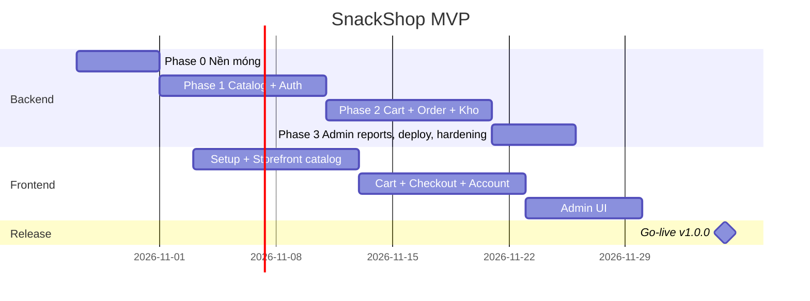

# 12 — Roadmap và kế hoạch thực thi

Ước lượng cho **1 dev backend full-time + frontend song song** (hoặc 1 người làm cả hai thì nhân đôi thời gian). Tuần = 5 ngày làm việc. Mỗi task ≈ 1 issue GitHub.

Ngày bắt đầu giả định **27/10/2026**. Điều chỉnh khi bắt đầu thật.

## Phase 0 — Nền móng (tuần 1)

Mục tiêu: một request đi xuyên 4 lớp, có test, có CI, có Docker. Chưa có nghiệp vụ.

| # | Task | Deliverable | Ước lượng |
|---|---|---|---|
| 0.1 🟡 | `git init`, cấu trúc thư mục, `.editorconfig`, `.gitignore`, `.gitattributes` ✅ — **còn lại**: commit đầu tiên, tạo repo GitHub, push, bảo vệ `main` | Repo | 0.5d |
| 0.2 ✅ | `backend/SnackShop.slnx`, 4 project src + 4 project tests, `Directory.Build.props` (warnaserror, nullable), `Directory.Packages.props` | Build xanh | 0.5d |
| 0.3 ✅ | Domain `Common/`: `Entity`, `AggregateRoot`, `Result`, `Result<T>`, `Error`, `ErrorType`, `ValidationError`, `IDomainEvent`, `Money` + unit test. Value object viết bằng `sealed record` (không cần base `ValueObject`) | | 0.5d |
| 0.4 ✅ | Application: `ICommand/IQuery/Handler` abstractions, MediatR 12 đăng ký, `ValidationBehavior`, `LoggingBehavior`, `UnitOfWorkBehavior`, `PagedResponse<T>` | | 1d |
| 0.5 ✅ | Infrastructure: `ApplicationDbContext` (snake_case, Identity tables), `UnitOfWork`, `AuditableEntityInterceptor`, `DispatchDomainEventsInterceptor`, migration `Initial` | DB tạo được | 1d |
| 0.6 ✅ | Api: `Program.cs`, `IEndpointGroup` + auto map, `GlobalExceptionHandler` → ProblemDetails, `ResultExtensions.ToHttpResult`, Serilog JSON, OpenAPI + Scalar, health checks, CORS, rate limiter khung | `GET /health` chạy | 1d |
| 0.7 ✅ | `infra/docker-compose.yml` (postgres, mailpit), `Dockerfile`, `.env.example` | `docker compose up` + `dotnet run` | 0.5d |
| 0.8 ✅ | Test infra: `ApiFactory` + Testcontainers + Respawn, client có JWT theo role, Architecture tests (dependency rules + conventions). Project `TestCommon` builders để sang Phase 1 khi có entity đầu tiên cần builder | `dotnet test` xanh | 1d |
| 0.9 🟡 | CI `ci.yml`: format, build, test, vulnerable scan, export openapi + kiểm tra `backend/openapi.json` đã commit, migration script, Docker image → GHCR. **Chưa chạy thật** vì chưa push GitHub | PR đầu tiên xanh | 0.5d |
| 0.10 ✅ | Feature mẫu end-to-end: `ShopSettings` GET public + PUT admin (đơn giản, chạm mọi lớp) + 3 test | Mẫu cho feature sau | 0.5d |

**Definition of Done Phase 0**: clone → `docker compose up -d` → `dotnet run` → `/scalar` hiện endpoint settings; `dotnet test` xanh cả integration; CI xanh.

## Phase 1 — Catalog + Auth (tuần 2–3)

| # | Task | Ghi chú |
|---|---|---|
| 1.1 ✅ | Domain `Catalog`: `Category`, `Product`, `ProductVariant`, `ProductImage`, `Slug`, `Sku`, `Money`, `CatalogErrors` + unit test invariants | 1.5d |
| 1.2 ✅ | EF configurations + migration `AddCatalog`, index slug/sku | 0.5d |
| 1.3 ✅ | Admin categories: Create/Update/Delete(soft)/List/Reorder | 1d |
| 1.4 ✅ | Admin products: Create/Update/Delete(soft)/Get/List(filter, inactive) ; variants Add/Update/Remove ; status patch | 2d |
| 1.5 ✅ | Upload ảnh: `IFileStorage` + `LocalFileStorage`, validate magic bytes, endpoint images add/remove/primary/reorder, Nginx/StaticFiles phục vụ `/uploads` | 1d |
| 1.6 ✅ (search dùng cột `search_text` thay `unaccent`; `HybridCache` hoãn — ADR-0009) | Public: `GET /categories`, `GET /products` (filter, search ILIKE+unaccent, sort, paging), `GET /products/{slug}` ; `HybridCache` 60s + invalidate | 1d |
| 1.7 ✅ | Identity: `ApplicationUser`, roles seed, `RegisterCommand` (tạo `Customer`), `LoginCommand`, `JwtProvider`, `RefreshToken` entity + rotation + reuse detection, `LogoutCommand` | 2d |
| 1.8 ✅ | Google login: `IGoogleTokenVerifier`, `LoginWithGoogleCommand` | 0.5d |
| 1.9 ✅ | Forgot/reset password, confirm email; `IEmailSender` SMTP (MailKit) + template; Mailpit local | 1d |
| 1.10 ✅ | Policies, `ICurrentUser`, rate limit `/auth/*`; `/me` GET/PUT, `/me/password` | 0.5d |
| 1.11 ✅ | Admin users: list/create Staff, set roles, lock | 0.5d |
| 1.12 ✅ | Dev seed: 5 category, 30 product, ảnh placeholder | 0.5d |
| 1.13 ✅ | Integration tests cho mọi endpoint trên; test rotation/reuse | xuyên suốt |

**DoD**: Admin đăng nhập, tạo danh mục/sản phẩm có ảnh và biến thể qua Scalar; khách xem được qua public API; Google login hoạt động với client id thật.

## Phase 2 — Cart + Ordering + Inventory (tuần 4–5)

| # | Task | Ghi chú |
|---|---|---|
| 2.1 ✅ | Domain `Inventory`: `StockItem`, `StockMovement`, reserve/commit/release/return, `InsufficientStock`, `xmin` + unit test | 1d |
| 2.2 ✅ (`StockItem` tạo trong handler, cùng transaction — ADR-0009) | Tự tạo `StockItem` khi tạo variant (domain event handler); admin inventory endpoints: list, movements, receive, adjust, threshold | 1d |
| 2.3 ✅ | Domain `Customers`: `Customer`, `Address`, `Cart`, `CartItem`; `/me/addresses/*`, `/me/cart/*` (+ merge) | 1.5d |
| 2.4 ✅ | Domain `Ordering`: `Order`, `OrderItem`, `OrderStatusHistory`, `Payment`, `ShippingAddress`, `OrderNumber`, toàn bộ state machine + unit test từng ô bảng chuyển trạng thái | 2d |
| 2.5 ✅ | `PlaceOrderCommand`: validate items, snapshot giá, `IShippingCalculator` flat rate, reserve stock, `Payment` theo method, `TransferContent`, `Idempotency-Key`; `POST /orders/estimate` | 1.5d |
| 2.6 ✅ (QR qua `img.vietqr.io`, không dùng QRCoder — ADR-0009) | Email xác nhận đơn (kèm VietQR cho CK: sinh ảnh QR bằng `QRCoder` theo chuẩn VietQR/NAPAS từ `ShopSettings.BankBin`) | 1d |
| 2.7 ✅ | Admin orders: list(filter)/get/confirm(+markPaid)/prepare/ship/deliver/cancel/mark-paid/internal-note; mỗi chuyển trạng thái tác động kho đúng bảng | 1.5d |
| 2.8 ✅ | Customer: `/me/orders`, `/me/orders/{no}`, cancel khi Pending; guest `GET /orders/track` | 0.5d |
| 2.9 ✅ (idempotency nằm trên cột `orders.idempotency_key`, không cần dọn) | Background job: hủy đơn CK quá 24h (release kho), dọn refresh token hết hạn, dọn idempotency key | 0.5d |
| 2.10 ✅ | Email cho confirm/ship/deliver/cancel; `SoldCount` khi Delivered | 0.5d |
| 2.11 ✅ | Integration test luồng đầy đủ: đặt → reserve → confirm → trừ kho → ship → deliver; đặt → hủy → trả kho; oversell concurrency (2 request song song) | 1d |

**DoD**: Đặt được đơn guest và customer với COD/CK; kho khớp tuyệt đối sau mọi chuyển trạng thái; email nhận trong Mailpit có QR.

## Phase 3 — Admin reports, deploy, hardening (tuần 6)

| # | Task | Ghi chú |
|---|---|---|
| 3.1 ✅ | Reports: dashboard summary, revenue series (group by day), top products, low stock | 1d (query SQL tối ưu, chỉ đơn `Delivered`) |
| 3.2 ✅ | Admin customers list/detail | 0.5d |
| 3.3 🟡 (header bảo mật ở Nginx, CORS, rate limit, lockout, Dependabot xong; còn: chạy `dotnet list package --vulnerable` trên CI, đổi mật khẩu admin, tập restore trên VPS thật) | Security checklist [07](07-auth-security.md#8-checklist-bảo-mật) đi hết | 0.5d |
| 3.4 ✅ | VPS: cài Docker, ufw, fail2ban, user deploy; `docker-compose.prod.yml`, Nginx, Let's Encrypt | 1d |
| 3.5 ✅ | CD `deploy.yml`: build image → GHCR → ssh deploy → migration sql → health → rollback | 1d |
| 3.6 ✅ | Backup/restore script + cron + rclone; **tập restore** | 0.5d |
| 3.7 ⬜ (cần tài khoản UptimeRobot/Better Stack + bot Telegram của chủ shop) | Uptime monitor, Seq (tùy chọn), cảnh báo Telegram | 0.5d |
| 3.8 🟡 (đo sơ bộ bằng ApacheBench trên máy dev — Docker Desktop dùng chung CPU, không đại diện VPS: `GET /products` ~20–27 ms/request khi tuần tự, ~87 rps / p95 1,4 s ở 50 kết nối sau khi tối ưu truy vấn. **Cần đo lại bằng k6 trên VPS thật** trước go-live) | Load test nhanh `GET /products` với k6 (mục tiêu p95 < 300ms @ 50 VU) | 0.5d |
| 3.9 ⬜ | Coverage gate bật trong CI | 0.25d |
| 3.10 ⬜ (sau khi push GitHub và CI xanh) | Tag `v1.0.0` | |

## Frontend (song song từ tuần 2)

| Tuần | Nội dung |
|---|---|
| 2 | Init Next.js, Tailwind, shadcn, openapi client, layout storefront, trang chủ + danh mục + chi tiết SP (ISR) |
| 3 | Giỏ hàng (Zustand persist), đăng nhập/đăng ký/Google, BFF auth route, `/me` |
| 4 | Checkout + estimate + trang đơn hàng + QR CK, tra cứu đơn, lịch sử đơn, sổ địa chỉ |
| 5 | Admin: layout, login, dashboard, sản phẩm (CRUD, upload ảnh, biến thể), danh mục |
| 6 | Admin: đơn hàng (list/filter/detail/chuyển trạng thái), kho, cài đặt, khách hàng; Playwright luồng đặt hàng |

## Phase 4 — Sau MVP (backlog, theo thứ tự giá trị)

1. **VNPay / MoMo**: `IPaymentGateway` impl, endpoint IPN/return, `Payment.RawPayload`, trạng thái `Processing`.
2. **Mã giảm giá**: module `Promotions`, `Coupon`, áp vào `PlaceOrder`, `DiscountAmount`.
3. **Đánh giá sản phẩm** có duyệt.
4. **Vận chuyển GHN/GHTK**: `IShippingCalculator` theo địa chỉ, tạo vận đơn, webhook trạng thái.
5. **Thông báo**: Zalo OA / SMS cho đơn mới (admin) và trạng thái (khách); Telegram bot cho admin.
6. **Outbox pattern** cho email/thông báo đảm bảo gửi; Redis cho `HybridCache` khi ≥ 2 instance.
7. **Full-text search** `tsvector` + `pg_trgm`.
8. **2FA cho Admin**, nhật ký hoạt động admin (audit log).
9. **PWA / mobile app** dùng cùng API.
10. Danh mục nhiều cấp, thuộc tính sản phẩm động, combo/bundle.

## Definition of Done chung (mọi task)

- [ ] Code theo [04-coding-conventions.md](04-coding-conventions.md), 0 warning.
- [ ] Unit test Domain cho invariant mới; integration test cho endpoint mới (happy + failure + auth).
- [ ] OpenAPI cập nhật (`.WithName`, `.Produces`); frontend client regenerate nếu đổi contract.
- [ ] Migration nếu đổi schema, review file migration.
- [ ] Docs cập nhật nếu đổi nghiệp vụ/kiến trúc; ADR nếu đổi quyết định.
- [ ] PR ≤ 400 dòng, CI xanh, squash merge.
- [ ] Chạy thử trên local qua Scalar hoặc UI.

## Rủi ro và cách giảm

| Rủi ro | Giảm thiểu |
|---|---|
| Over-engineering Clean Architecture làm chậm MVP | Feature mẫu Phase 0.10 làm template copy; handler ≤ 60 dòng; không thêm pattern ngoài docs nếu không có ADR |
| Oversell khi nhiều người mua cùng lúc | Reserve ngay khi đặt + `xmin` concurrency + test song song (2.11) |
| Chuyển khoản phải xác nhận tay, chậm | `TransferContent` chuẩn + QR; Phase 4 tích hợp cổng hoặc API ngân hàng (Casso/SePay) đọc giao dịch tự động |
| Một người làm cả BE + FE bị quá tải | Ưu tiên BE xong Phase 2 rồi mới làm FE; dùng Scalar làm "UI" tạm cho admin |
| Mất dữ liệu VPS | Backup ngoài VPS từ Phase 3, tập restore |
| License NuGet đổi (MediatR v13, FluentAssertions v8) | Pin MediatR 12.x, dùng Shouldly; Dependabot chỉ minor/patch |
